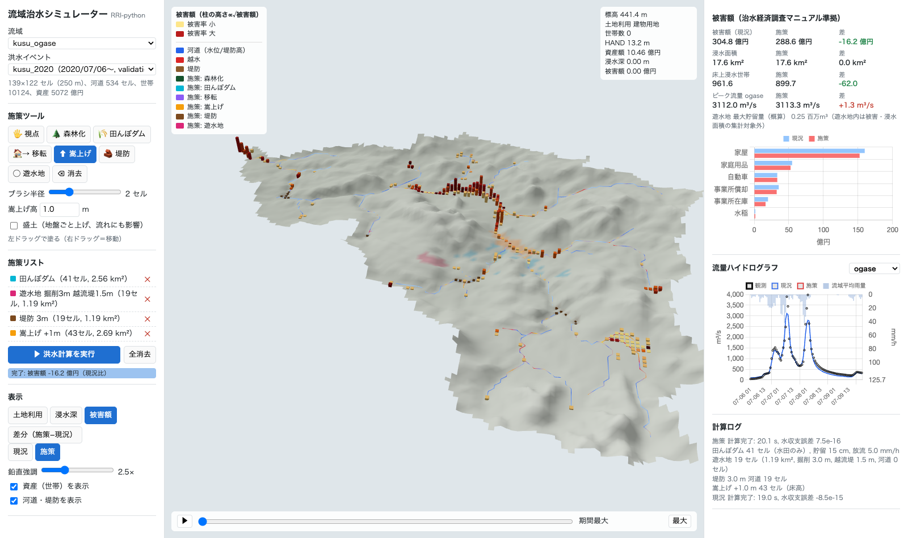

# rri-sim — RRIモデルの物理式に基づく流域治水シミュレーター（Python）

降雨流出・洪水氾濫を流域一体で解く RRI モデル（Sayama et al., 2012）の支配方程式を Python/Numba で再実装し、
公開データ（国土地理院・国土交通省・気象庁・e-Stat）から実流域モデルを自動構築して、
過去洪水の再現・検証、治水経済調査マニュアルに基づく被害額推計、治水政策の比較を行う研究用コード。

## 構成

```
rri_sim/
  kernels.py      斜面2D・河道1D・河道⇄斜面交換・Green-Ampt（Numba, 有限体積法）
  solver.py       時間積分（適応dt, 水収支台帳, ダム操作）
  domain.py       計算領域・河道網
  hydro.py        窪地処理, D8, 流量累積, HAND
  basin.py        実流域モデルの自動構築（DEM→流域界→河道網→土地利用）
  forcing.py      降雨（区分一定・厳密積分）・流入ハイドログラフ
  events.py       雨量観測所データの収集と格子化（IDW）
  cases.py        対象流域・洪水イベントの登録
  damage.py       治水経済調査マニュアル（案）R7.7 の被害率・評価単価
  assets.py       e-Stat メッシュ統計から資産基礎数量
  scenarios.py    浚渫・堤防嵩上げ・遊水地・土地利用変更
  metrics.py      NSE, KGE, ピーク誤差, CSI 等
  workflow.py     流域構築＋プリセット＋境界条件（ダム・潮位・低平地排水）
  levees.py       DEM5A（5 m）からの既設堤防天端・堤間幅の推定
  indicators.py   Livability / Ecology / 安全・安心 指標
  costs.py        施策の事業費（初期・維持・現在価値）
  climate.py      気候変動シナリオ（降雨の拡大・強雨強調・空間倍率・海面上昇）
  gui/            3D GUI（FastAPI + three.js）: engine.py, server.py, static/
  data/           gsi_dem, mlit_water, jma, landuse, estat（キャッシュ付き取得）
scripts/          run_event.py, calibrate.py, damage_from_result.py, compare_schemes_levee.py
tests/            検証テスト（解析解・V字流域・保存性・被害率）
docs/             00 セットアップ / 01 定式化 / 02 データと計画 / 03 被害額 / 04 進捗報告 / 05 GUI / 06 指標・事業費 / 07 気候変動 / 08 メッシュサイズ
```

## 3D GUI（施策を塗って洪水計算・被害額を比較）

```bash
.venv/bin/python -m rri_sim.gui      # → http://127.0.0.1:8765        （専門家向け: すべての設定）
                                     #   http://127.0.0.1:8765/play   （授業向けゲーム: 予算・ミッション・スコア）
```

clone 直後に GUI を動かすまでの手順（環境構築・流域ごとの事前計算）は [docs/00_setup.md](docs/00_setup.md)。

森林化・田んぼダム・住宅移転/嵩上げ・堤防・遊水地を地図上（3D／2D）で塗り、洪水計算を実行して、
浸水深の時間変化、全観測所の流量、被害額、**事業費**、**Livability / Ecology Score**（都市構造の評価に関するハンドブック準拠の指標）を
現況と比較できる。**気候変動シナリオ**（国交省提言の降雨量変化倍率 2℃/4℃、任意倍率、強雨強調、海面上昇）の下でも計算できる。
対象: 玖珠川、阿武隈川上流、**筑後川全域**、**阿武隈川全域**。計算メッシュは 125／250（標準）／500／1000 m から選べる（500 m で計算時間 1/4〜1/20, [docs/08](docs/08_resolution.md)）。詳細は [docs/05_gui.md](docs/05_gui.md)、[docs/06_indicators.md](docs/06_indicators.md)。



## 使い方

```bash
python -m venv .venv && .venv/bin/pip install -e ".[dev]"
.venv/bin/python -m pytest                       # 検証テスト
.venv/bin/python scripts/run_event.py kusu_2020  # 玖珠川 2020年7月豪雨（データ自動取得）
.venv/bin/python scripts/run_event.py kusu_2020 --preset --res 500                # 500 mメッシュ（高速）
.venv/bin/python scripts/calibrate.py sample --event kusu_2018 --n 40
.venv/bin/python scripts/run_event.py chikugo_2020 --preset --climate 4C            # 4℃上昇（九州北西部 ×1.4, 海面+0.73 m）
.venv/bin/python scripts/run_event.py kusu_2020 --preset --climate custom --rain-factor 1.2
.venv/bin/python scripts/climate_scenarios.py kusu_ogase kusu_2020 ogase           # シナリオ一括比較
```

取得データは `data/raw/`（git管理外）にキャッシュされる。
