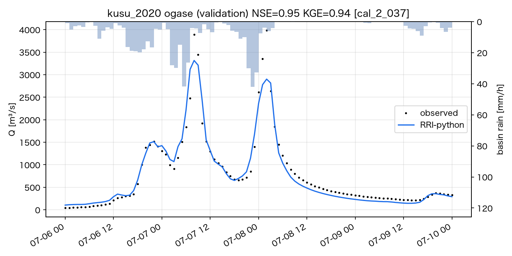
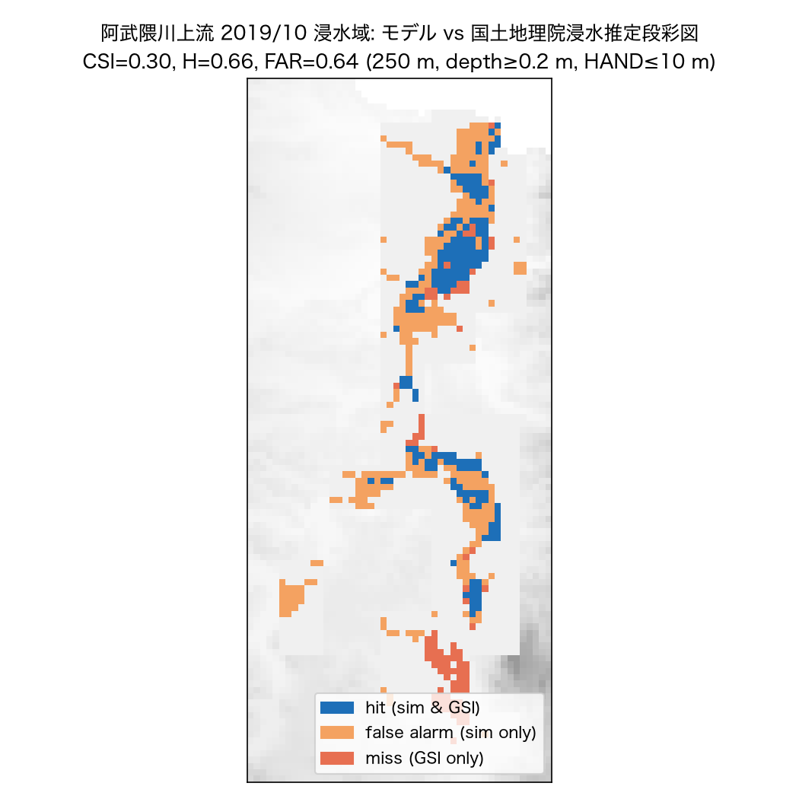

# 4. 進捗報告（2026-10-10 時点）

## 4.1 到達点のまとめ

| 段階 | 内容 | 状態 | 主要結果 |
|---|---|---|---|
| 0 | RRI支配方程式・データ入手性の調査 | ✅ | docs/01, docs/02 |
| 1 | コア実装（斜面2D・河道1D・浸透・交換・ダム） | ✅ | 保存誤差 < 1e-12（全ケース） |
| 2 | 合成流域での検証 | ✅ | 25テスト合格（解析解・V字流域・dt収束・スキーム比較） |
| 3a | 筑後川支川 玖珠川（小ヶ瀬, 528 km²）2020年7月豪雨 | ✅ | **検証イベントで NSE 0.95, KGE 0.94** |
| 3b–c | 筑後川 荒瀬・瀬ノ下・下流平野 | 🔜 | ダム（松原・下筌）モジュール実装済、花月川の浸水推定図取得可 |
| 4 | 阿武隈川上流（阿久津, 1,854 km²）2019年台風19号 | 🔄 | 須賀川 NSE 0.98（未校正）、浸水域 CSI 0.30 |
| 5 | 被害額・政策比較 | 🔄 | マニュアルR7.7準拠の算定・資産メッシュ自動整備・シナリオ比較の枠組み完成 |

## 4.2 数値検証（段階2）

`pytest`: 25 passed（約15秒）。

| 項目 | 結果 |
|---|---|
| 水収支（全テスト・実流域計算） | 相対誤差 1e-15〜1e-11 |
| 静水保持 | 水位変動 0（1e-12） |
| 傾斜平面 vs kinematic wave解析解 | 誤差 < 5%（両スキーム） |
| V字流域 平衡流量 | 4.86 m³/s（理論値と ±1%以内） |
| Green–Ampt 解析解 | 相対誤差 < 1e-6 |
| 局所慣性 vs 拡散波（RRI原法）, 堤防越流ケース | 流出ピーク差 0.4%、最大浸水深 RMSE 1.2 cm、**計算時間 2.4 s vs 555 s** |

## 4.3 筑後川水系 玖珠川（段階3a）

- 領域: 250 m格子, 8,448セル, 河道534セル（上流域5 km²以上）, 流域面積528 km²（DEMから自動抽出）
- 雨量: 国交省27地点＋アメダス11地点のIDW（1時間）。スピンアップ: 約1か月前から観測雨量で計算。
- **校正/検証の分離**: 2018年7月で校正（ランダム探索40本, 5パラメータ）、2012年7月・2021年8月・**2020年7月で独立検証**。
  パラメータ選択は校正イベントのNSEのみで行い、検証結果は選択に用いていない。

採用パラメータ（cal_2_037）: 森林 n=0.080, k_a=0.050 m/s, 土層厚0.52 m, C_w=10.2, 河道 n=0.040

| イベント | 役割 | 観測ピーク [m³/s] | NSE | KGE | ピーク誤差 | 遅れ | 総量誤差 |
|---|---|---|---|---|---|---|---|
| 2018/7 | 校正 | 2,345 | 0.982 | 0.934 | +2% | +1 h | +6% |
| 2012/7 | 検証 | 2,535 | 0.961 | 0.978 | −9% | −1 h | 0% |
| 2021/8 | 検証 | 2,708 | 0.953 | 0.879 | −17% | +1 h | −3% |
| **2020/7** | **検証** | **3,982** | **0.946** | **0.940** | **−17%** | 約+1 h | **−3%** |

アプリオリ値（校正なし）では 2020/7 で NSE 0.73、ピーク −45%。

**改善の経緯（失敗も含めて記録）**
1. 初期条件ゼロ（乾燥土壌）では総量 −36%。→ 約1か月のスピンアップで −12%。
2. 平均化DEMの窪地（pit）に水が溜まり、応答が遅れ浸水が点状に出る。→ RRIと同様に窪地埋めDEMを斜面に使用。
3. 窪地埋めは河床に平坦区間（“湖”）を作り、下流端水位をせき上げる（阿武隈川で顕著）。
   → 生DEMの河床縦断を最小二乗単調回帰（PAVA）で補正し、出口勾配は下流5 km平均。阿武隈 阿久津の NSE が 0.13 → 0.87。
4. 同一イベントで校正・評価しない設計に変更（2018校正 → 2012/2021/2020検証）。

**同定性（equifinality）**: 校正上位セットで k_a が 0.02〜0.27 m/s と大きく異なっても同程度の再現性。
単一地点の流量だけでは地中流パラメータは同定できない → 内部地点（竹中の水位）、複数イベント同時校正で制約する。

## 4.4 阿武隈川上流（段階4, 2019年台風19号）

- 領域: 29,669セル, 河道2,316セル, 流域面積1,854 km²。雨量: 国交省26＋アメダス22地点。
- 計算時間: 30日（スピンアップ込）で約200〜280 s（M系 Mac, 1コア）。

| 地点 | パラメータ | NSE | KGE | ピーク誤差 | 総量誤差 |
|---|---|---|---|---|---|
| 須賀川 (1,190 km²) | アプリオリ | **0.981** | 0.919 | −2% | +5% |
| 阿久津 (1,854 km²) | アプリオリ | 0.867 | 0.589 | −29% | −32% |
| 須賀川 | 玖珠川校正値を移植 | 0.764 | 0.703 | +54% | +14% |
| 阿久津 | 玖珠川校正値を移植 | 0.861 | 0.741 | +14% | −25% |

- **観測値の整合性チェック**: 10/11–18の観測流出高は阿久津 234 mm、須賀川 156 mm。
  差分の残流域（664 km²）では流出高 約374 mm となり、同域の雨量（272 mm）を上回る。
  雨量計網の過小評価または阿久津の高水流量（H-Q式の外挿）の過大評価が示唆され、阿久津の総量誤差 −32% の一部は観測側に起因する可能性が高い。
- パラメータの地域移植は不十分（玖珠＝火山岩・急峻、阿武隈＝花崗岩風化帯）。地質区分ごとのパラメータ化が必要。
- 浸水域（国土地理院 浸水推定段彩図との比較, 250 m, 浸水深≥0.2 m, HAND≤10 m）:
  CSI 0.30, Hit rate 0.66, FAR 0.64（モデル 30 km² vs 推定図 16 km²）。主因は**堤防を未考慮**（全河道で堤防高0）。

## 4.5 被害額（段階5, 機能確認）

玖珠川2020（校正パラメータ、浸水深≥0.1 m かつ HAND≤10 m）: 被害額 約345億円、床上浸水 約1,230世帯相当、浸水面積23 km²。
**この数値は検証前の参考値**であり、250 m格子では狭い谷底の浸水がセル全体に広がるため過大の可能性が高い。
水害統計（市町村別被害額・浸水棟数）との照合と、谷底平野の細格子化が必要。

## 4.6 計算時間

| ケース | セル数 | シミュレーション期間 | 実時間 |
|---|---|---|---|
| V字流域（検証） | 4,050 | 3 h | 0.4 s |
| 堤防越流（局所慣性 / 拡散波） | 2,460 | 12 h | 2.4 s / 555 s |
| 玖珠川 250 m | 8,448 | 30 日 | 105–130 s |
| 阿武隈川上流 250 m | 29,669 | 30 日 | 200–280 s |

全流域への拡張（筑後川 2,860 km² ≈ 46k セル、阿武隈川全体 5,400 km² ≈ 86k セル）は 1イベント 10〜20分程度の見込み。
校正（数十〜数百本）には並列実行（現状 ProcessPool 10並列）を利用。

## 4.7 残された課題（優先順）

1. **堤防・河道断面**: DEM5A（5 m, 航空レーザ）から河道セル内の堤防天端高を推定、国の管理区間は河川整備計画の代表断面で補正 → 浸水域の FAR 低減。
2. **筑後川本川への拡張**: 松原・下筌ダム（一定量放流モデル実装済、操作実績で検証）、大石・山田・床島堰の取水、下流の潮位境界（若津）。
3. **阿武隈川の地域校正**: 別イベント（例 2011年9月・2023年）で校正し2019年で検証。三春ダム、本宮〜二本松の氾濫による流量減衰（観測で 4,523→3,659 m³/s）の再現。
4. **降雨入力**: 解析雨量（有償）またはXRAIN（DIAS）が入手できれば置換。現状は雨量計IDWで局所豪雨のピークを過小評価しうる。
5. **浸水深の検証**: 段彩図の凡例（色→深さ）を取り込み、浸水深の bias/RMSE を算定。浸水推定図は特定時刻の推定である点に注意。
6. **被害額の検証**: 水害統計との照合、延床面積（JACIC）・平均階数の整備、谷底平野の細格子（50–100 m）入れ子化。
7. **8方向流・地下水・蒸発散**: 長期計算と減水部の再現性向上（現状、減水後半をやや過小）。
8. **不確実性評価**: 同定性の問題を踏まえ、パラメータ集合（上位セット）によるアンサンブルで政策効果の幅を示す。
