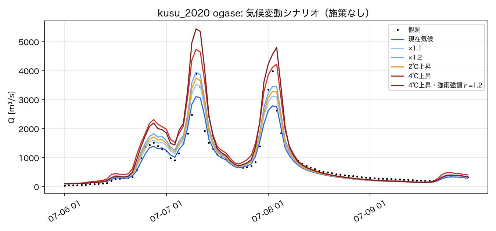
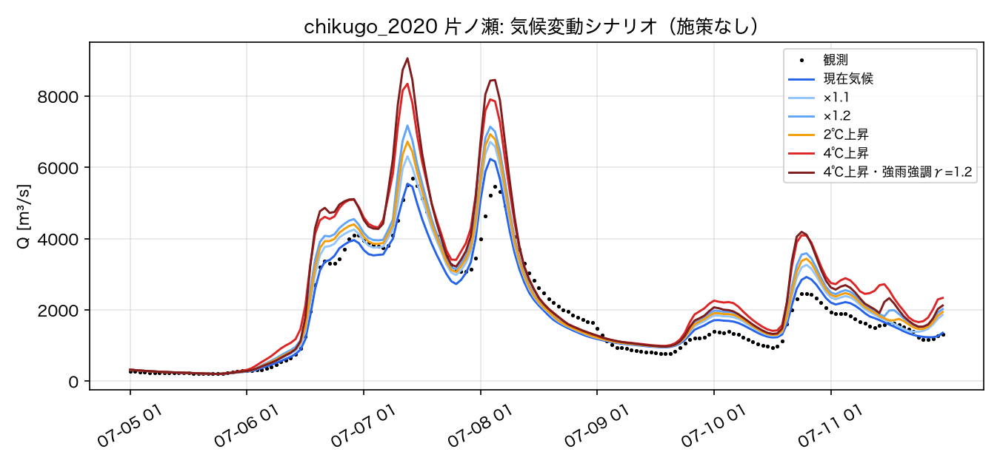
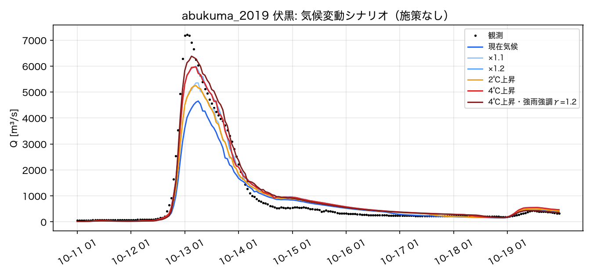

# 7. 気候変動下の計算

実装: `rri_sim/climate.py`（シナリオ・降雨の拡大・潮位上昇）、GUI「気候条件」、`scripts/run_event.py --climate`、
`scripts/climate_scenarios.py`（シナリオ一括計算）

## 7.1 将来気候データの入手可能性

| データ | 内容 | 入手 | 本実装での扱い |
|---|---|---|---|
| d4PDF / 気候予測データセット2022（全国版d4PDFダウンスケーリング, NHRCM 5 km, 1時間値, 過去実験・4℃上昇実験, 各732年） | 大量アンサンブルの将来降雨 | DIAS（ユーザー登録・申請が必要） | 本環境からは取得不可。取得後に**変化倍率の空間分布（将来/過去の比）をGeoTIFFで与えれば適用可能**（`--factor-raster`、`climate.load_factor_raster`） |
| 国交省「気候変動を踏まえた治水計画のあり方」提言（改訂版, 2021） | 計画降雨の降雨量変化倍率 | 公開 | **プリセットとして実装**（下表） |
| 気象庁・文科省「日本の気候変動2020」 | 21世紀末の日本沿岸の平均海面水位上昇 | 公開 | **潮位境界に加算** |

## 7.2 シナリオの与え方

- **降雨**: 観測された洪水（評価期間）の時間雨量を格子ごとに拡大する（国交省の計画降雨の拡大と同じ考え方）。
  - `rain_factor`: 評価期間の総雨量の倍率（例 1.1, 1.2, 1.4）
  - `intensity_gamma`: 1 = 一様拡大。>1 で強い時間帯ほど大きく増やす（r' = c·r^γ、c は総量が倍率どおりになるよう格子ごとに決定）。
    時間雨量の極値が総雨量より大きく増えるという予測（提言の「短時間」倍率：4℃で1.3〜1.5）を表現するためのオプション。
  - `factor_field`: 空間分布する倍率（d4PDF等から作成）
  - 前期降雨（スピンアップ期間）は既定で現在気候のまま（`--climate-spinup` で拡大も可）。
- **海面**: 下流端の観測潮位に平均海面上昇量を加える。

### プリセット

| 流域 | 降雨の地域区分 | 2℃上昇 | 4℃上昇 | 海面上昇の領域 | 2℃ / 4℃ |
|---|---|---|---|---|---|
| 筑後川・玖珠川 | 九州北西部 | ×1.15 | ×1.4 | IV（北陸〜九州の東シナ海側） | +0.39 / +0.73 m |
| 阿武隈川 | その他12地域 | ×1.1 | ×1.2 | I（北海道・東北） | +0.38 / +0.70 m |

出典: 降雨量変化倍率＝国交省提言（改訂版）の地域区分表（2℃: 北海道北部・南部・九州北西部 1.15、その他 1.1。4℃: 同 1.4、その他 1.2）。
筑後川を「九州北西部」に区分した点は提言の地域区分図で要確認。海面上昇＝日本の気候変動2020（正誤表反映）。

## 7.3 結果（施策なし、パラメータ・境界条件は現在気候と同一）

### 玖珠川 2020年7月豪雨（評価期間 7/6–7/10）

（`scripts/climate_scenarios.py kusu_ogase kusu_2020 ogase`）

| シナリオ | 降雨倍率 | γ | 海面上昇 [m] | 評価期間雨量 [mm] | 被害額 [億円] | 浸水面積 [km²] | 床上世帯 | ピーク ogase [m³/s] | ピーク takenaka [m³/s] |
|---|---|---|---|---|---|---|---|---|---|
| 現在気候 | 1.00 | 1.00 | 0.00 | 570 | 304.8 | 17.6 | 962 | 3112 | 2474 |
| ×1.1 | 1.10 | 1.00 | 0.00 | 627 | 360.0 (+18%) | 20.4 (+16%) | 1176 | 3529 (+13%) | 2521 (+2%) |
| ×1.2 | 1.20 | 1.00 | 0.00 | 684 | 436.4 (+43%) | 23.4 (+33%) | 1384 | 3952 (+27%) | 2562 (+4%) |
| 2℃上昇 | 1.15 | 1.00 | 0.39 | 655 | 396.4 (+30%) | 21.8 (+24%) | 1332 | 3749 (+20%) | 2542 (+3%) |
| 4℃上昇 | 1.40 | 1.00 | 0.73 | 798 | 537.5 (+76%) | 27.8 (+57%) | 1716 | 4737 (+52%) | 2632 (+6%) |
| 4℃上昇・強雨強調γ=1.2 | 1.40 | 1.20 | 0.73 | 798 | 676.8 (+122%) | 31.8 (+80%) | 2176 | 5446 (+75%) | 2711 (+10%) |

### 筑後川全域 2020年7月豪雨

（`scripts/climate_scenarios.py chikugo_whole chikugo_2020 片ノ瀬`。被害額の絶対値は過大—変化率を参照）

| シナリオ | 降雨倍率 | γ | 海面上昇 [m] | 評価期間雨量 [mm] | 被害額 [億円] | 浸水面積 [km²] | 床上世帯 | ピーク 小渕 [m³/s] | ピーク 小ヶ瀬 [m³/s] | ピーク 花月 [m³/s] | ピーク 荒瀬 [m³/s] | ピーク 片ノ瀬 [m³/s] | ピーク 端間 [m³/s] | ピーク 瀬ノ下 [m³/s] |
|---|---|---|---|---|---|---|---|---|---|---|---|---|---|---|
| 現在気候 | 1.00 | 1.00 | 0.00 | 763 | 22263.4 | 412.8 | 74572 | 7161 | 3496 | 196 | 7791 | 6236 | 826 | 4649 |
| ×1.1 | 1.10 | 1.00 | 0.00 | 839 | 26086.2 (+17%) | 442.3 (+7%) | 80993 | 8143 (+14%) | 3951 (+13%) | 226 (+16%) | 8771 (+13%) | 6716 (+8%) | 933 (+13%) | 4999 (+8%) |
| ×1.2 | 1.20 | 1.00 | 0.00 | 915 | 28811.0 (+29%) | 467.4 (+13%) | 86809 | 9368 (+31%) | 4457 (+27%) | 350 (+79%) | 9759 (+25%) | 7174 (+15%) | 1056 (+28%) | 5480 (+18%) |
| 2℃上昇 | 1.15 | 1.00 | 0.39 | 877 | 27686.1 (+24%) | 455.2 (+10%) | 84001 | 8616 (+20%) | 4194 (+20%) | 250 (+28%) | 9265 (+19%) | 6932 (+11%) | 985 (+19%) | 5243 (+13%) |
| 4℃上昇 | 1.40 | 1.00 | 0.73 | 1068 | 35464.1 (+59%) | 516.6 (+25%) | 99543 | 12737 (+78%) | 5296 (+52%) | 539 (+175%) | 13292 (+71%) | 8348 (+34%) | 1350 (+64%) | 6360 (+37%) |
| 4℃上昇・強雨強調γ=1.2 | 1.40 | 1.20 | 0.73 | 1068 | 39163.4 (+76%) | 561.2 (+36%) | 113921 | 14949 (+109%) | 6341 (+81%) | 728 (+272%) | 15276 (+96%) | 9062 (+45%) | 1575 (+91%) | 6753 (+45%) |

- ダム直下の小渕は4℃で +78%（現在気候で既に下筌・松原が満杯となり、それ以上の調節ができない）。下流の片ノ瀬・瀬ノ下は氾濫原貯留で増加率が小さい。

### 阿武隈川全域 2019年台風19号

（`scripts/climate_scenarios.py abukuma_whole abukuma_2019 伏黒`。現在気候で流量が過小（docs/04 4b）のため変化率を参照）

| シナリオ | 降雨倍率 | γ | 海面上昇 [m] | 評価期間雨量 [mm] | 被害額 [億円] | 浸水面積 [km²] | 床上世帯 | ピーク 須賀川 [m³/s] | ピーク 阿久津 [m³/s] | ピーク 本宮 [m³/s] | ピーク 二本松 [m³/s] | ピーク 福島 [m³/s] | ピーク 伏黒 [m³/s] | ピーク 丸森 [m³/s] | ピーク 舘矢間 [m³/s] | ピーク 江尻 [m³/s] |
|---|---|---|---|---|---|---|---|---|---|---|---|---|---|---|---|---|
| 現在気候 | 1.00 | 1.00 | 0.00 | 326 | 6985.9 | 373.8 | 26394 | 1231 | 2604 | 2962 | 3061 | 4041 | 4652 | 4701 | 5111 | 4321 |
| ×1.1 | 1.10 | 1.00 | 0.00 | 358 | 9070.4 (+30%) | 416.9 (+12%) | 31883 | 1240 (+1%) | 2907 (+12%) | 3352 (+13%) | 3483 (+14%) | 4633 (+15%) | 5351 (+15%) | 5163 (+10%) | 5950 (+16%) | 4811 (+11%) |
| ×1.2 | 1.20 | 1.00 | 0.00 | 391 | 11697.7 (+67%) | 463.1 (+24%) | 38991 | 1235 (+0%) | 3186 (+22%) | 3680 (+24%) | 3836 (+25%) | 5246 (+30%) | 5992 (+29%) | 5587 (+19%) | 6856 (+34%) | 5248 (+21%) |
| 2℃上昇 | 1.10 | 1.00 | 0.38 | 358 | 9099.3 (+30%) | 417.6 (+12%) | 31893 | 1240 (+1%) | 2907 (+12%) | 3352 (+13%) | 3483 (+14%) | 4632 (+15%) | 5249 (+13%) | 5162 (+10%) | 5929 (+16%) | 4811 (+11%) |
| 4℃上昇 | 1.20 | 1.00 | 0.70 | 391 | 11874.4 (+70%) | 463.8 (+24%) | 39135 | 1235 (+0%) | 3186 (+22%) | 3680 (+24%) | 3836 (+25%) | 5246 (+30%) | 5967 (+28%) | 5583 (+19%) | 6835 (+34%) | 5248 (+21%) |
| 4℃上昇・強雨強調γ=1.2 | 1.20 | 1.20 | 0.70 | 391 | 14009.5 (+101%) | 504.4 (+35%) | 47074 | 1235 (+0%) | 3370 (+29%) | 3863 (+30%) | 4030 (+32%) | 5597 (+38%) | 6382 (+37%) | 5846 (+24%) | 7393 (+45%) | 5472 (+27%) |

## 7.4 解釈と注意

- 国交省提言は「2℃上昇で降雨量約1.1倍・流量約1.2倍・洪水発生頻度約2倍」としている。玖珠川では降雨×1.15（2℃, 九州北西部）で
  小ヶ瀬のピーク流量が +20% となり、整合的である。
- 被害額は降雨倍率より大きく増える（浸水深の増加が被害率の段階を上げるため）。強雨強調（γ>1）では同じ総雨量でもピークと被害がさらに増える。
- 将来の土地利用・人口・資産は現在のまま（気候のみ変化）。人口減少等を考慮する場合は資産データの将来推計が必要。
- 観測1洪水の拡大であり、将来の洪水の時空間パターン（降雨域の移動・継続時間）の変化は表現しない。これには d4PDF 等の
  アンサンブル降雨を直接入力する方法（DIASでのデータ取得後）が必要。
- 全域モデルの被害額の絶対値は過大（docs/04 4b）。気候による**変化率**と施策の**相対比較**として用いること。
- 座標系: 筑後川・玖珠川のモデルは EPSG:6690（UTM 53帯）で構築されている（九州には52帯 EPSG:6689 が最適）。
  距離の尺度誤差は約0.14%（面積約0.3%）で結果への影響は無視できるが、次回の再構築時に修正する。
